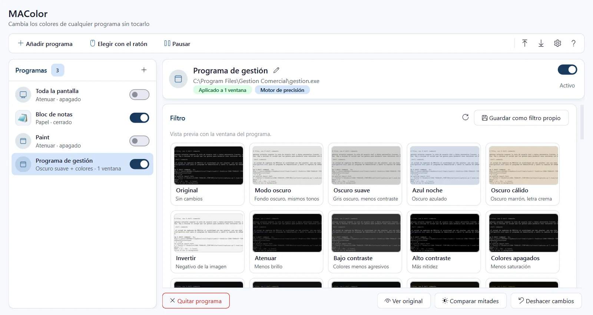
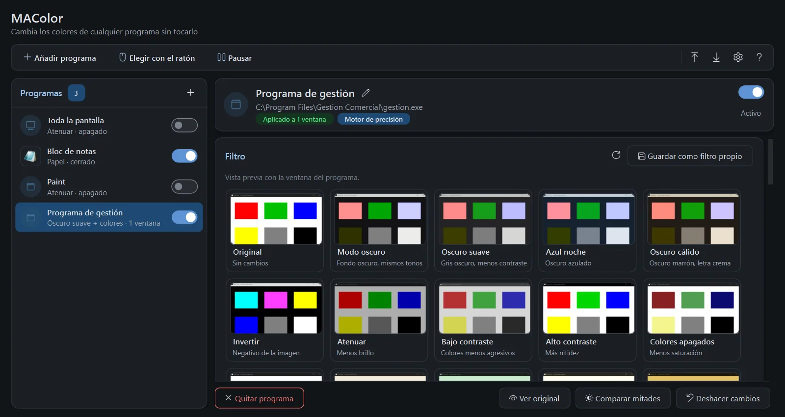
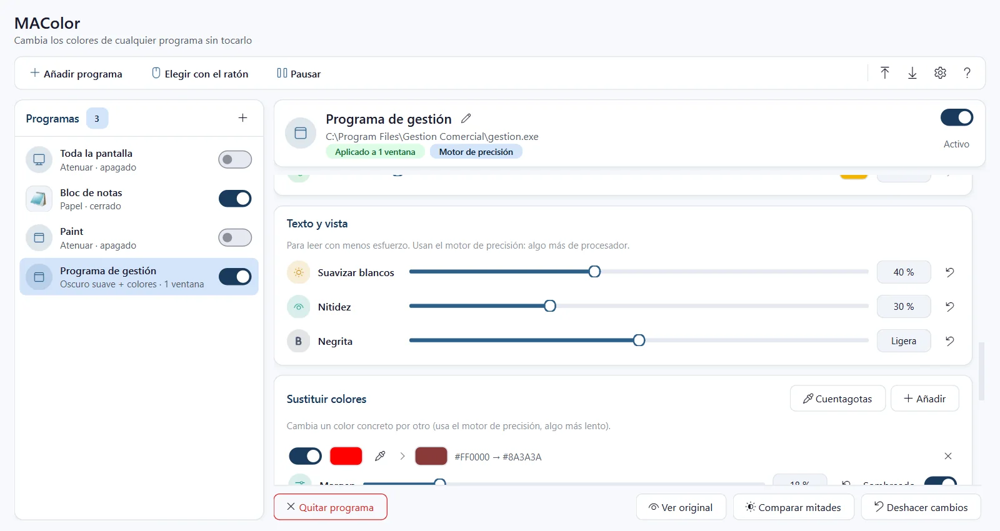
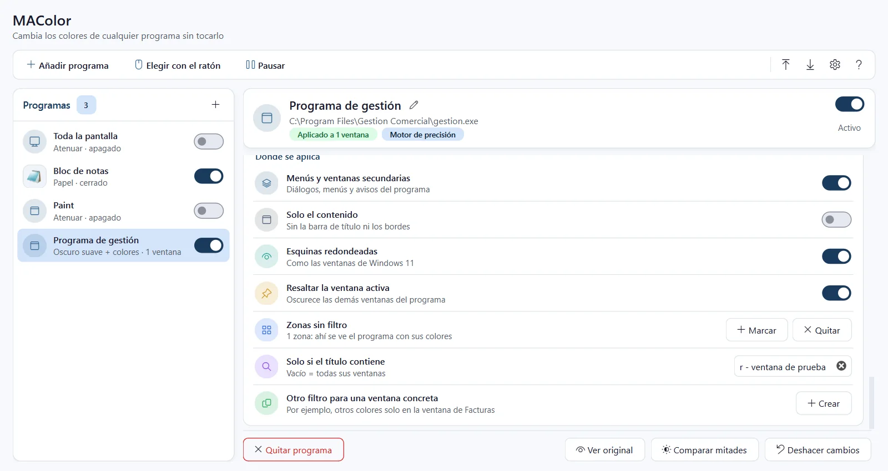
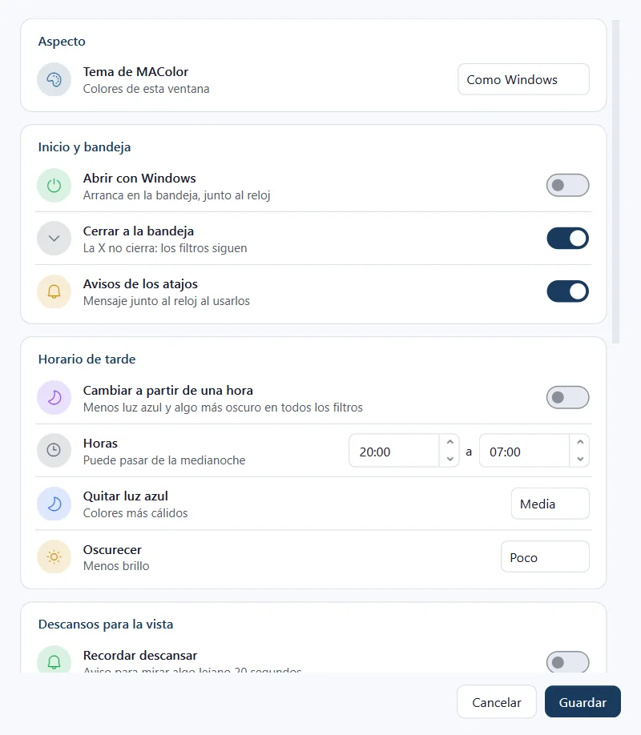

# MAColor

Cambia los colores de cualquier programa que no tenga temas ni modo oscuro, sin tocarlo: pone encima de su ventana una capa transparente que vuelve a pintar lo que hay debajo con otros colores. El programa se usa exactamente igual.

**Software gratuito desarrollado por [Masoft.es](https://masoft.es)**

[](https://github.com/MaSoft/MAColor/releases/latest)

También puedes descargarlo desde [masoft.es](https://masoft.es/descargas.html).



## Características
- 15 filtros listos: modo oscuro, oscuro suave, azul noche, sepia, grises, alto contraste y más.
- Vista previa con la ventana real de tu programa y ajustes finos en directo.
- Sustituir un color concreto por otro, con cuentagotas.
- Recuerda cada programa: al abrirlo, sus colores cambian solos. Uno distinto para cada programa o ventana.
- Texto y vista: suavizar blancos, nitidez para la letra fina y negrita simulada.
- Zonas sin filtro, horario de tarde con menos luz azul y avisos de descanso para la vista.
- Atajos de teclado, filtros desde la bandeja y exportar e importar tus filtros.

## Capturas

| | |
|---|---|
| <br>**Tema oscuro.** La ventana de MAColor en tema oscuro. | <br>**Texto y vista.** Suavizar blancos, nitidez, negrita y sustituir colores concretos. |
| <br>**Dónde se aplica.** Menús, zonas sin filtro, resaltar la ventana activa y filtro por ventana. | <br>**Ajustes.** Inicio con Windows, horario de tarde y descansos para la vista. |

## Requisitos

| | |
|---|---|
| Sistema | Windows 10 u 11 de 64 bits. Sustituir colores y «Texto y vista» necesitan Windows 10 versión 2004 o posterior |
| Permisos | No necesita administrador |
| Instalación | No hace falta: un solo .exe que se copia y se abre. Python va dentro |
| Espacio | 48 MB el programa; los ajustes ocupan unos pocos KB |
| Internet | No lo usa para nada |

No modifica ni lee los datos del otro programa: solo cambia cómo se ve en tu monitor.

## Descarga y comprobación

En [Releases](https://github.com/MaSoft/MAColor/releases/latest) están el programa (`MAColor_v1.1.1.exe`), su huella SHA-256 y el manual. Para comprobar que la descarga está completa, en PowerShell:

```powershell
Get-FileHash .\MAColor_v1.1.1.exe
```

Debe coincidir con `db06e95a33e6a9b05b7ccb7d7678c98796be6461c6e33ae15a9b9128f8489854`.

## Manual

[manual_MAColor.html](https://github.com/MaSoft/MAColor/releases/latest/download/manual_MAColor.html): descárgalo y ábrelo en el navegador.

## Aviso legal

MAColor es gratuito y se entrega tal cual, sin garantía de ningún tipo. Al descargarlo y usarlo aceptas el aviso legal y las limitaciones de su manual.

> MAColor solo cambia cómo se ven las ventanas en tu monitor. No lee, no modifica ni guarda el contenido de los demás programas y no se conecta a Internet. En equipos de empresa, úsalo de acuerdo con las normas de uso de software de tu organización.

**Limitaciones**
- Se entrega «tal cual», sin garantía de funcionamiento en todos los programas, tarjetas gráficas o configuraciones de Windows.
- Un filtro de color no sustituye a una adaptación de accesibilidad prescrita; si tienes un problema de visión, consulta a un profesional.
- Los colores que se ven filtrados no son los reales: no lo uses para trabajos en los que la exactitud del color importe (diseño, imprenta, fotografía).
- Las capas no aparecen en capturas de pantalla ni al compartir pantalla: lo que otros ven es el programa original.

Este repositorio solo contiene el programa compilado y su documentación. © Masoft.es. Todos los derechos reservados.
